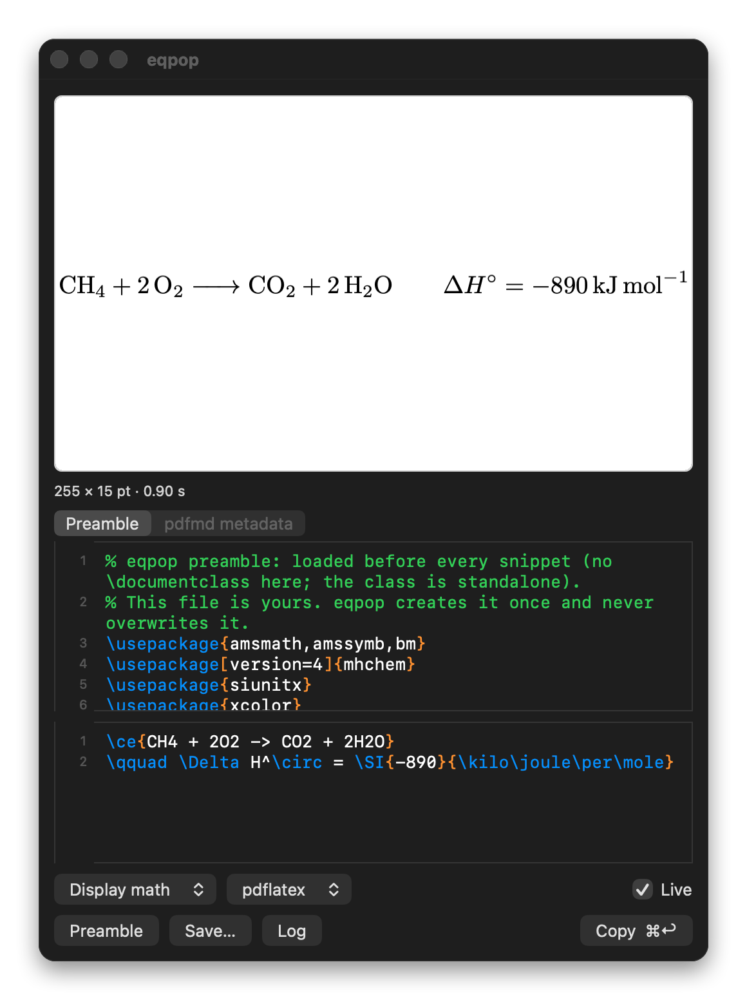
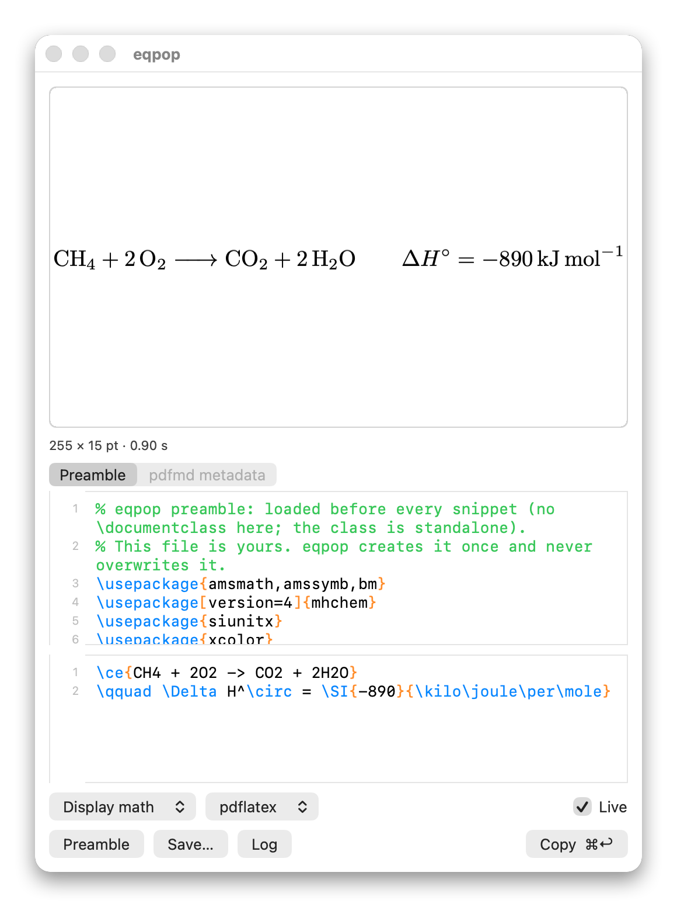
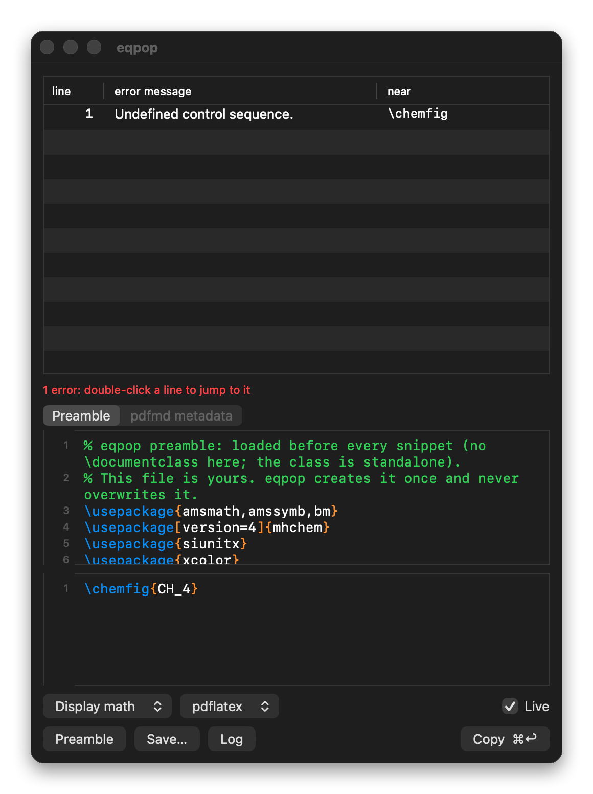

# eqpop

A menu-bar popup that renders LaTeX (math, chemistry with `mhchem`, or plain text) to a tightly cropped
vector PDF and puts it on the clipboard. A global hotkey (default ⌥⇧T, changeable from the menu) shows a
floating window; type, watch the live preview, press ⌘↩ to copy (PDF and PNG) and the window hides, giving the
focus back to the app you came from. The preview can also be dragged into Keynote, Word or Finder.

- **Persistent preamble**: `~/Library/Application Support/eqpop/preamble.tex`. Written once on the first launch,
  never overwritten; edit it in the app ("Preamble…") or in any editor. Every render reads it from disk.
- **Auto-crop**: the engine's `standalone` class crops the page, then the ink is measured and the page boxes are
  trimmed to it (any engine's PDF gets the same treatment; the page stays vector).
- **Engines**: `pdflatex`, `lualatex`, `xelatex`, found by absolute path (a Finder-launched app has no PATH).
  `pdflatex` renders from a cached, compiled preamble (the first render after a preamble change is slower).
- **Markdown through [pdfmd](https://github.com/aliperdehan/pdfmd)**: pick the `pdfmd` engine and the source is a Markdown document (math, `\ce{}`, tables,
  whatever pdfmd builds), cropped to its ink like the rest. The preamble goes to pdfmd as `preamble.tex` and the
  pane's "pdfmd metadata" tab as `metadata.yaml` (a `pdfmd-options:` block works there), so a house style applies;
  a second popup picks pdfmd's PDF engine (typst takes about a second, pdflatex four, lualatex ten). It never renders
  while typing: ⌘R or ⌘↩. The pdfmd used is `$EQPOP_PDFMD`, else `~/dev/py/pdfmd/pdfmd.py`, else `pdfmd` on the path
  (`pipx install pdfmd-cli`).
- **Errors**: a failed render shows a table of every error (line, message, near) in place of the preview, like
  LaTeXiT; double-click a row to jump to the line. **Log** shows the full log.
- **Live**: the checkbox (or the menu) turns rendering-while-typing off; ⌘R renders, ⌘↩ renders and copies.
- **Looks**: follows the system's light or dark appearance (the preview stays a white sheet, so black text reads in
  both). Line numbers in both editors. The preview sits above the editor, as in LaTeXiT, or below it: the menu-bar
  menu and the View menu have "Preview above the editor" and "Line numbers".
- **Export**: Save… (⌘S) writes PDF, PNG or SVG (SVG needs `pdftocairo` from poppler, or `mutool`).

  
  
  

## Install

**Download** (Apple Silicon): `eqpop-<version>-macos-arm64.zip` from the
[Releases](https://github.com/aliperdehan/eqpop/releases) page, unzip, move `eqpop.app` to `~/Applications` and open it.
It is not notarized, so macOS refuses it the first time: System Settings → Privacy & Security → Open Anyway, or
`xattr -dr com.apple.quarantine ~/Applications/eqpop.app`. Or build it from source:

Needs macOS 13 or newer, the Xcode Command Line Tools (`xcode-select --install`) and a TeX distribution (MacTeX or
BasicTeX).

    git clone https://github.com/aliperdehan/eqpop.git
    cd eqpop
    ./build.sh --install

That builds the app, copies it to `~/Applications/eqpop.app` and starts it. It has no Dock icon: look for the `f(x)`
in the menu bar, and press ⌥⇧T (or choose "Show eqpop") for the window. The menu also has "Launch at login" and
"Change shortcut…". To update, `git pull` and run `./build.sh --install` again.

For the Markdown engine install [pdfmd](https://github.com/aliperdehan/pdfmd) (`pipx install pdfmd-cli`). For SVG
export, `brew install poppler` (or `mupdf-tools`).

`./build.sh` alone only builds `build/eqpop.app` (`open build/eqpop.app` starts it). The app is ad-hoc signed, not
notarized: built on your own machine it opens normally; a copy downloaded from somewhere else needs System Settings →
Privacy & Security → Open Anyway. The icon and the menu-bar glyph are set in STIX (SIL OFL, shipped with macOS).

## Without the window

    eqpop --render '\ce{2H2 + O2 -> 2H2O}' out.pdf [--inline|--text] [--engine lualatex] [--preamble FILE] [--png FILE]

`open build/eqpop.app --args --show` opens the window at launch (for testing without the hotkey).

## License

MIT.
